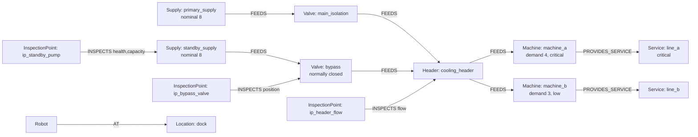

# Graph data model (v1)

> v1 drafted by Claude from CLAUDE.md §6 and `docs/proposal.md` §5; decision points DP1–DP5 reviewed and
> accepted by Siddharth (D-008).
> All capacities and equipment are **synthetic simulation assumptions**.

## Decision points (accepted, D-008)

| # | Question | v1 choice | Why (short) |
|---|---|---|---|
| **DP1** | Is an asset's *current state* (valve position, standby capacity, pump health) a property on the asset node, or only the latest `Observation`? | **Only Observations.** Assets hold static design facts (`nominal_capacity`, `demand`, `criticality`); anything that changes is an `Observation` node. | One source of truth for state; every belief has time + provenance, so freshness is queryable. Avoids "stale property nobody updated". |
| **DP2** | `FEEDS` and `CONNECTED_TO`: both, or one? | **Both.** `CONNECTED_TO` = physical pipe (undirected meaning). `FEEDS` = directed operational flow path (non-return assumed). | Proposal's key distinction: connected ≠ able to supply. Impact traversal uses `FEEDS`; whether flow is *sufficient* is computed in `planning/capacity.py`, never inferred from a path. |
| **DP3** | `InspectionPoint`: secondary label of `Asset` (CLAUDE.md draft) or its own node? | **Own node** `:InspectionPoint`, `-[:INSPECTS {property}]->(:Asset)`, `-[:LOCATED_IN]->(:Location)`. | An inspection point isn't equipment: it doesn't feed, fail, or carry load. Putting it under `Asset` would pollute impact traversals (`MATCH (a:Asset)` would return gauges). |
| **DP4** | Robot position: pose property on `:Robot`, or a relationship? | **`(:Robot)-[:AT]->(:Location)`**, moved **only after verified arrival** (`robot.base.arrived`). `x, y` live on `Location` (D-005). | Location-gated sensing becomes a graph check (`robot AT loc ← ip LOCATED_IN loc`). Edge moves on *observed* arrival, not on command (invariant #3). |
| **DP5** | How do hypothetical branches represent predicted effects? | Transition model writes **`Observation` nodes with `source: "predicted"`** into the `GRAPH.COPY` branch. | The **same** evaluation queries run unchanged on main and branch graphs, and predicted facts can never be confused with real ones (source is explicit; branches are deleted). |

## Conventions
- Every node has a string `id` (stable, human-readable: `primary_supply`, `ip_standby_pump`).
- Times are epoch seconds (`float`), simulation clock.
- Relationships are created in one direction; symmetric ones (`CONNECTED_TO`, `ADJACENT_TO`) are queried undirected `-[:R]-`.
- Labels are nouns, relationships are verbs in UPPER_SNAKE.

## Node labels

### Infrastructure
| Label | Key properties | Notes |
|---|---|---|
| `Asset:Supply` | `id, name, nominal_capacity` (units) | Primary = 8; standby = 8 / 5 / unavailable **per scenario, as truth**: the graph only knows `nominal_capacity`; actual capacity is an Observation (DP1). |
| `Asset:Valve` | `id, name, normally` (`"open"`/`"closed"`) | Position is evidence, not a property. |
| `Asset:Header` | `id, name` | Shared cooling header. |
| `Asset:Machine` | `id, name, demand` (units), `criticality` (`"critical"`/`"low"`) | A = 4 critical, B = 3 low. |
| `Service` | `id, name, critical` (bool) | Business function a machine provides (e.g. "Line A production"). Answers "which affected services are critical?". |
| `Location` | `id, name, x, y` | Robot-navigable places. Coordinates feed the robot adapter (D-005). |
| `InspectionPoint` | `id, name` | Where the robot can read a property (DP3). |
| `Sensor` | `id, kind` | Fixed sensors (e.g. machine A temperature alarm). |
| `Robot` | `id, name` | One robot in MVP. |

### Evidence & hypotheses
| Label | Key properties | Notes |
|---|---|---|
| `Observation` | `id, property, value, unit, observed_at, ingested_at, quality` (0–1), `source` (`"robot"`/`"sensor"`/`"log"`/`"predicted"`), `mission_id` | Never overwritten; latest per (asset, property) wins. Freshness windows per property live in `evidence/freshness.py` and are passed to queries as a parameter map. |
| `Incident` | `id, opened_at, status` | Groups everything about one fault. |
| `Hypothesis` | `id, name, status` (`"open"`/`"supported"`/`"rejected"`) | e.g. primary failure, restricted flow, wrong valve state, faulty temp reading. |

### Actions & planning
| Label | Key properties | Notes |
|---|---|---|
| `Action` | `id, name, kind` | e.g. `activate_standby`, `open_bypass`, `reduce_load_b`, `isolate_primary`. |
| `Condition` | `id, property, op, value, kind` (`"evidence"`/`"computed"`), `check` | Evidence condition: latest fresh Observation must satisfy `op value`. Computed condition (e.g. `check: "demand_within_capacity"`) is evaluated by `planning/capacity.py`. |
| `Plan` | `id, name` | A candidate sequence. |
| `PlanStep` | `id, order` | |
| `Decision` | `id, made_at, summary` | Provenance root for explanations. |
| `StateRevision` | `n, at` | Monotonic counter, bumped on every evidence insert; used for recheck-before-act (invariant #4). |
| `ExecutionAttempt` | `id, sent_at, ack_at, status` (`"sent"`/`"acked"`/`"verified"`/`"failed"`) | Command ≠ ack ≠ verified (invariant #3). |

## Relationships

### Infrastructure
| Type | From → To | Properties | Meaning |
|---|---|---|---|
| `FEEDS` | `Asset → Asset` | `max_flow` (optional) | Directed operational flow path. |
| `CONNECTED_TO` | `Asset — Asset` | | Physical pipe; no implication of sufficiency (DP2). |
| `LOCATED_IN` | `Asset / InspectionPoint / Sensor → Location` | | |
| `PROVIDES_SERVICE` | `Machine → Service` | | |
| `MEASURES` | `Sensor → Asset` | `property` | Fixed sensor coverage. |

### Robot access
| Type | From → To | Properties | Meaning |
|---|---|---|---|
| `ADJACENT_TO` | `Location — Location` | `cost` (seconds) | Navigable hop; route = cheapest path. |
| `INSPECTS` | `InspectionPoint → Asset` | `property` | What can be read there (`health`, `capacity`, `position`, `flow`, `temperature`). |
| `AT` | `Robot → Location` | `since` | Current verified location (DP4). Exactly one. |

### Evidence & hypotheses
| Type | From → To | Properties |
|---|---|---|
| `ABOUT` | `Observation → Asset` | |
| `PRODUCED_BY` | `Observation → Sensor / Robot` | |
| `DURING` | `Observation → Incident` | |
| `SUPPORTS` / `CONTRADICTS` | `Observation → Hypothesis` | `rule` (which rule fired). Evidence, **not causation**. |
| `HAS_HYPOTHESIS` | `Incident → Hypothesis` | |
| `EXPECTS` | `Hypothesis → Asset` | `property, op, value`: the observation pattern this hypothesis predicts |
| `DISTINGUISHED_BY` | `Hypothesis → InspectionPoint` | |

### Actions, plans, provenance
| Type | From → To | Properties |
|---|---|---|
| `REQUIRES` | `Action → Condition` | |
| `CONDITION_ON` | `Condition → Asset` | |
| `AFFECTS` | `Action → Asset` | `property, value` (declared effect, used by transition model) |
| `HAS_STEP` | `Plan → PlanStep` | |
| `EXECUTES` | `PlanStep → Action` | |
| `NEXT` | `PlanStep → PlanStep` | |
| `TRIGGERED_BY` | `Decision → Incident` | |
| `CONSIDERED` | `Decision → Plan` | |
| `REJECTED` | `Decision → Plan` | `reason` (validator output) |
| `SELECTED` | `Decision → Plan` | |
| `BASED_ON` | `Decision → Observation` | |
| `AT_REVISION` | `Decision → StateRevision` | |
| `RESULTED_IN` | `PlanStep → ExecutionAttempt` | |
| `VERIFIED_BY` | `ExecutionAttempt → Observation` | |

**Milestone 1 additions:** `(:Incident)-[:CONCERNS]->(:Asset)` (alarming asset);
`(:ExecutionAttempt {asset_id, property, expected, sent_at, ack_at, status})-[:ATTEMPTS]->(:Action)`,
`-[:DURING]->(:Incident)`, `-[:VERIFIED_BY]->(:Observation)`; `StateRevision` is a singleton
`{id: 'current', n, at}` incremented by every `insert_observation` (Decisions will record `n`).

**Changes vs CLAUDE.md §6 draft:** `InspectionPoint` is its own label (DP3); added `AT`, `MEASURES`, `EXECUTES`, `HAS_HYPOTHESIS`; dropped `REQUIRES_SERVICE` and `HAS_CAPABILITY` for v1 (machine cooling demand is a property; one robot with fixed capabilities; add back if multi-capability inspection matters).

## Facility instance (scenario baseline)

Locations (`dock`, `primary_bay`, `standby_bay`, `header_room`, `machine_hall`) are linked by `ADJACENT_TO {cost}`; each asset and inspection point is `LOCATED_IN` one of them.

## Query patterns this model enables (implemented in `graph/queries/`)
| Question | Pattern |
|---|---|
| What's downstream of X? (multi-hop impact) | `(x:Asset {id})-[:FEEDS*1..]->(d:Asset)` |
| Which critical services are hit? | …`(d:Machine)-[:PROVIDES_SERVICE]->(s:Service {critical:true})` |
| Alternate supplies for a machine | `(s:Supply)-[:FEEDS*]->(m:Machine {id})` where `s` ≠ faulted |
| Latest evidence for (asset, property) | `(o:Observation {property})-[:ABOUT]->(a)` ordered by `observed_at` desc, limit 1 |
| Stale / missing evidence | latest observation older than `$windows[property]`, or none |
| Can the robot read X here? | `(r:Robot)-[:AT]->(l)<-[:LOCATED_IN]-(ip)-[:INSPECTS]->(x)` |
| Prerequisites of an action | `(a:Action {id})-[:REQUIRES]->(c:Condition)-[:CONDITION_ON]->(x)` |
| Why was this chosen? | `(d:Decision {id})-[:CONSIDERED|REJECTED|SELECTED|BASED_ON]->(...)` |

## Indexes (to add in `graph/schema.py`)
Range indexes on `id` for `Asset, Location, InspectionPoint, Action, Hypothesis, Incident, Decision`;
on `Observation.property` (latest-evidence lookups). Verify FalkorDB index syntax in docs before writing.
